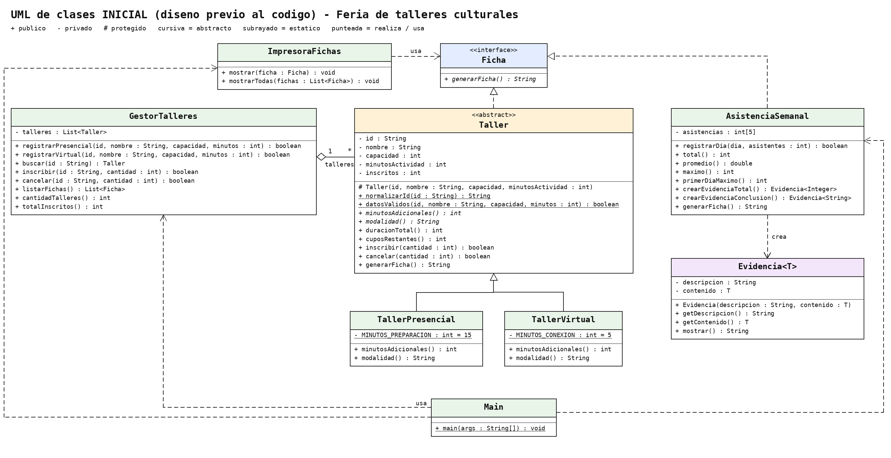
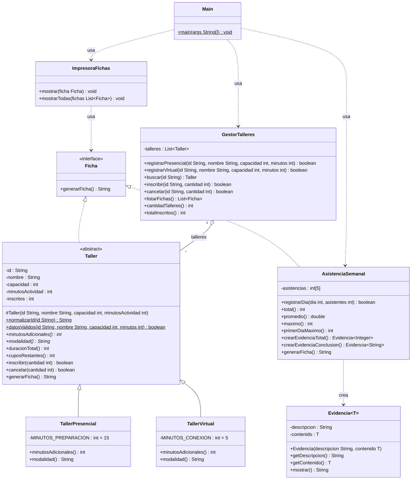
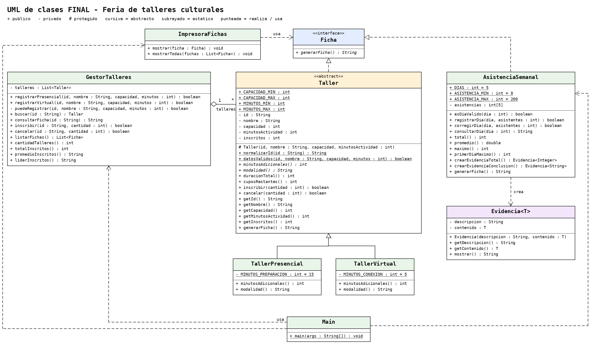
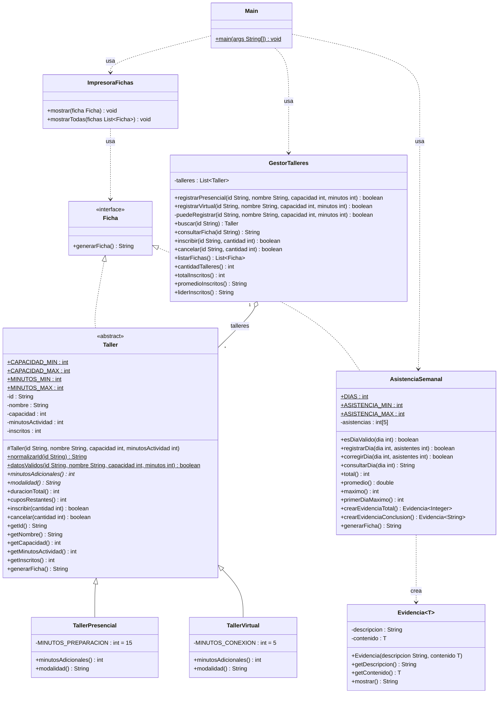

# Reto 1 · Feria de talleres culturales

Aplicación de consola en Java (JDK 21 o 17, sin librerías externas) para registrar talleres presenciales y virtuales, controlar cupos y resumir la asistencia de cinco días.

## 1. Integrantes y aportes

> Completar con los datos reales del grupo antes de entregar.

| Integrante | Aportes |
| --- | --- |
| _Nombre 1_ | _p. ej. `Taller`, `TallerPresencial`, `TallerVirtual`_ |
| _Nombre 2_ | _p. ej. `GestorTalleres`, búsqueda por ID_ |
| _Nombre 3_ | _p. ej. `AsistenciaSemanal`, `Evidencia<T>`_ |
| _Nombre 4_ | _p. ej. `Main`, pruebas, README y UML_ |

## 2. Identificación del problema

- **¿Quién la necesita?** El personal de una casa cultural que organiza una feria de talleres presenciales y virtuales.
- **¿Qué dificultad tiene?** Evitar sobrecupos, conocer la duración real de cada actividad (según modalidad) y resumir la asistencia de cinco días sin repartir las reglas entre variables sueltas.
- **¿Qué resuelve?** Registrar talleres, buscarlos por ID, inscribir y cancelar cupos, listar fichas, contar talleres e inscritos, y analizar cinco asistencias diarias (total, promedio, máximo y primer día del máximo).
- **Queda fuera:** nombres de asistentes, pagos, fechas, videollamadas, persistencia, interfaz gráfica y menús obligatorios.

### Entradas, salidas y reglas

| Entradas | Salidas |
| --- | --- |
| ID, nombre, capacidad, minutos de actividad, modalidad; cantidad a inscribir/cancelar; cinco asistencias diarias | Aceptada/Rechazada por operación, fichas, cantidad de talleres, total de inscritos, duración total, total/promedio/máximo/día de asistencia, `Evidencia<Integer>` y `Evidencia<String>` |

**Reglas que siempre se cumplen**

1. ID obligatorio (no nulo ni en blanco), normalizado con `strip()` + `toUpperCase(Locale.ROOT)` al registrar **y al buscar**; no se repite tras normalizar y no cambia después.
2. Capacidad de 1 a 30; actividad de 1 a 180 minutos; inscritos empiezan en 0 y siempre están entre 0 y la capacidad.
3. Presencial suma 15 min de preparación; virtual suma 5 min de conexión.
4. Inscribir: cantidad positiva y que quepa en los cupos. Cancelar: cantidad positiva y no mayor a los inscritos. Un rechazo no cambia el estado.
5. Asistencias: 5 posiciones (día 1–5 = índice 0–4), valores de 0 a 200 (el 0 es válido). Posiciones inexistentes se rechazan sin alterar el arreglo. En empate de máximos gana el primer día. El arreglo no se ordena.
6. Lista vacía: contadores en 0 y `Sin datos` para promedio/líder. Búsqueda fallida: `No encontrado`. Nunca se entrega acceso modificable a la lista ni al arreglo.

## 3. Diseño

### Responsabilidades y estado

| Clase | Responsabilidad | Estado |
| --- | --- | --- |
| `Ficha` (interfaz) | Contrato mínimo: producir una ficha/reporte | — |
| `Taller` (abstracta) | Proteger las reglas de un taller y producir su ficha | id, nombre, capacidad, minutosActividad, inscritos |
| `TallerPresencial` / `TallerVirtual` | Aportar los minutos extra de su modalidad | constante propia (15 / 5) |
| `GestorTalleres` | Registrar, buscar, inscribir, cancelar y resumir | `List<Taller>` |
| `AsistenciaSemanal` | Proteger y resumir las 5 asistencias | `int[5]` |
| `Evidencia<T>` | Guardar descripción + contenido tipado | descripción, contenido |
| `ImpresoraFichas` | Cliente que muestra cualquier `Ficha` | — |
| `Main` | Preparar escenarios, mostrar y comparar resultados | — |

### «Es un» frente a «usa»

- `TallerPresencial` **es un** `Taller` y `TallerVirtual` **es un** `Taller`: comparten identidad, cupos y reglas, y solo varían en `minutosAdicionales()` (sobrescritura, sin `if` por modalidad).
- `Taller` y `AsistenciaSemanal` **son** `Ficha` (cumplen el contrato de producir una ficha).
- `GestorTalleres` **usa/tiene** talleres (composición): no es un taller. `ImpresoraFichas` **usa** `Ficha` sin conocer los tipos concretos. `AsistenciaSemanal` **usa** `Evidencia<T>` para exponer sus resultados.
- No se heredó solo para compartir campos: `AsistenciaSemanal` no extiende de `Taller`.

### Estructuras elegidas

| Necesidad | Estructura | Justificación |
| --- | --- | --- |
| Cinco asistencias fijas | `int[5]` | Tamaño conocido, cada posición es un día (índice 0–4); no cambia de tamaño ni se ordena. |
| Talleres de cantidad variable | `List<Taller>` con `ArrayList<>` | Se agrega al final (orden de registro), se recorre por posición y no hay inserciones/borrados intermedios que justifiquen `LinkedList`. Se programa contra la interfaz `List<T>`. |
| Evidencias de distinto tipo | Clase genérica `Evidencia<T>` | Una sola clase con `Integer` (total) y `String` (conclusión), sin raw types ni casts. |

No hay arreglos paralelos: todos los atributos de un taller viven en el mismo objeto.

## 4. UML inicial (diseño previo al código)

> Conservar este bloque en el historial Git (commit del diseño antes de programar).

Imagen guardada en el repositorio: [`docs/uml-inicial.png`](docs/uml-inicial.png) (vector: [`docs/uml-inicial.svg`](docs/uml-inicial.svg)).



Versión Mermaid del mismo diseño:



## 5. UML final (coincide con el código)

El diseño inicial **sigue vigente**; solo se agregaron métodos de apoyo durante la implementación: `corregirDia`, `consultarDia` y `esDiaValido` en `AsistenciaSemanal`; `consultarFicha`, `promedioInscritos` y `liderInscritos` en `GestorTalleres` (para mostrar `No encontrado` y `Sin datos` sin lógica en `Main`); y constantes de rango en `Taller` y `AsistenciaSemanal`.

Imagen guardada en el repositorio: [`docs/uml-final.png`](docs/uml-final.png) (vector: [`docs/uml-final.svg`](docs/uml-final.svg)).



Versión Mermaid:



## 6. Cómo ejecutar

Estructura: `src/feria/*.java` (paquete `feria`, clase principal `feria.Main`).

**IntelliJ IDEA:** crear un proyecto Java (JDK 21 o 17, sin Maven/Gradle), marcar `src` como *Sources Root* y ejecutar `feria.Main`.

**Terminal (con JDK instalado):**

```bash
javac -d out src/feria/*.java
java -cp out feria.Main
```

`Main` reproduce con datos fijos el escenario base y las pruebas adicionales; imprime `[OK]`/`[FALLA]` comparando el resultado esperado con el obtenido (no usa `Scanner`).

## 7. Pruebas

Resultados obtenidos al ejecutar `feria.Main`: **74 de 74 coinciden**. Cada bloque usa objetos nuevos y no se mezcla con el escenario base.

### Escenario base

| Entrada / acción | Esperado | Obtenido | ¿Coincide? |
| --- | --- | --- | --- |
| Registrar T-01 presencial Pintura (cap. 3, 60 min) | Aceptada | Aceptada | Sí |
| Registrar T-02 virtual Fotografia (cap. 2, 40 min) | Aceptada | Aceptada | Sí |
| Inscribir 2 en T-01 | Aceptada, T-01: 2 | Aceptada, 2 | Sí |
| Inscribir otros 2 en T-01 | Rechazada, T-01: 2 | Rechazada, 2 | Sí |
| Inscribir 1 en T-02 | Aceptada, T-02: 1 | Aceptada, 1 | Sí |
| Cancelar 1 en T-01 | Aceptada, T-01: 1 | Aceptada, 1 | Sí |
| Talleres / total de inscritos / promedio | 2 / 2 / 1.0 | 2 / 2 / 1.0 | Sí |
| Duración T-01 / T-02 | 75 / 45 | 75 / 45 | Sí |
| Asistencias `[12, 8, 15, 0, 10]`: total, promedio, máximo, día | 45, 9.0, 15, 3 | 45, 9.0, 15, 3 | Sí |
| `Evidencia<Integer>` (total semanal) | 45 | 45 | Sí |
| `Evidencia<String>` (conclusión) | texto con pico 15 en el día 3 | `Pico de 15 asistentes el dia 3; promedio 9.0 por dia` | Sí |

### Pruebas adicionales

| Caso | Entrada | Esperado | Obtenido | ¿Coincide? |
| --- | --- | --- | --- | --- |
| ID duplicado (dato inválido) | `" t-01 "` con T-01 ya registrado | Rechazada; sigue 1 taller | Rechazada; 1 | Sí |
| ID en blanco / nulo | `"   "` / `null` | Rechazada | Rechazada | Sí |
| Nombre repetido, ID distinto | `T-03` "Pintura" | Aceptada | Aceptada | Sí |
| Capacidad 0 y 31 | límites inválidos | Rechazada | Rechazada | Sí |
| Minutos 0 y 181 | límites inválidos | Rechazada | Rechazada | Sí |
| Límites válidos (límite exacto) | cap. 1/1 min presencial; cap. 30/180 min virtual | Aceptada; duración 16 y 185 | Aceptada; 16 y 185 | Sí |
| Inscripción 0 y −1 | `T-01` | Rechazada; inscritos 0 | Rechazada; 0 | Sí |
| Cancelación superior a inscritos | cancelar 2 con 1 inscrito | Rechazada; conserva 1 | Rechazada; 1 | Sí |
| Cancelar exactamente los inscritos (límite) | cancelar 1 con 1 | Aceptada; 0 | Aceptada; 0 | Sí |
| Taller lleno exacto | cap. 2: inscribir 2, luego 1 | Aceptada; Rechazada; inscritos 2 | Aceptada; Rechazada; 2 | Sí |
| Lista vacía | gestor nuevo | 0 talleres, 0 inscritos, `Sin datos` | 0, 0, `Sin datos` | Sí |
| ID inexistente | `Z-99` (consultar, inscribir, cancelar) | `No encontrado` / Rechazada | `No encontrado` / Rechazada | Sí |
| Búsqueda normalizada | `" t-01 "` | Encontrado | Encontrado | Sí |
| Posición fuera del arreglo | consultar 0 y 6; corregir día 6 | `Posicion inexistente`; Rechazada; total sigue en 45 | igual | Sí |
| Valor de asistencia inválido | día 3 = 201 y −1 | Rechazada; total sigue en 45 | igual | Sí |
| Cero y 200 como valores válidos | día 4 = 0 y luego 200 | Aceptada; total 245; máximo 200 en día 4 | igual | Sí |
| Empate de máximos | `[5, 200, 3, 200, 0]` | primer día = 2 | 2 | Sí |
| Todo en cero | cinco ceros | 0 / 0.0 / 0 / día 1 | igual | Sí |

### Breakpoint utilizado

> Completar con su propia observación al depurar en IntelliJ (las capturas son opcionales).

Sugerencia: poner un breakpoint en la línea `inscritos += cantidad;` de `Taller.inscribir` y ejecutar el escenario base. Observar `inscritos` y `cuposRestantes()`: en la primera inscripción en T-01 se espera `inscritos = 0` antes y `2` después. En la segunda llamada (2 más, con un solo cupo disponible) el breakpoint **no se alcanza**: la condición `cantidad > cuposRestantes()` retorna `false` antes de modificar el estado. Anoten lo que observen realmente y qué regla comprobó.

## 8. Decisiones destacadas

- **Reglas dentro de las clases:** `Main` solo prepara escenarios y compara; las validaciones viven en `Taller`, `AsistenciaSemanal` y `GestorTalleres`.
- **Sin `if` por subtipo:** `Taller.duracionTotal()` llama a `minutosAdicionales()`, que cada subclase sobrescribe; las listas se recorren con referencias `Taller`/`Ficha`.
- **Encapsulamiento:** `listarFichas()` devuelve una copia no modificable de tipo `Ficha`; el arreglo de asistencias nunca se expone.
- **Rechazos con `boolean`:** los datos inválidos se validan antes de construir el objeto (`Taller.datosValidos`), así que nunca se agregan a la lista.
- **Promedio de asistencia:** el arreglo siempre tiene 5 posiciones, por lo que el divisor nunca es cero; `Sin datos` aplica a los resúmenes de la lista de talleres vacía.
